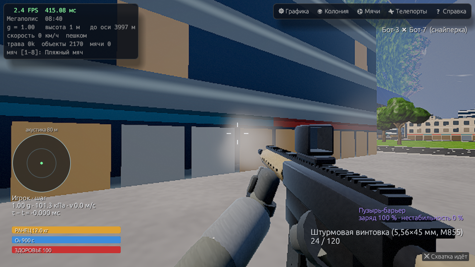
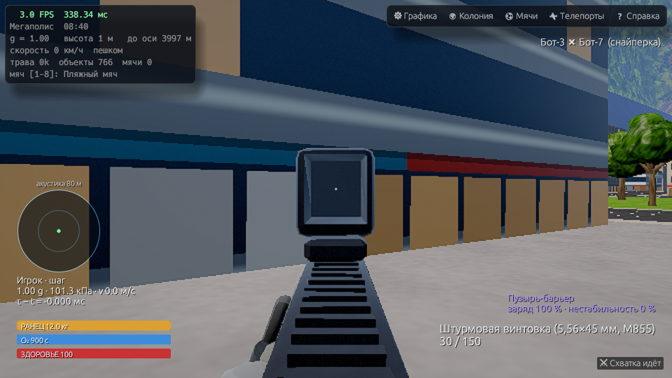
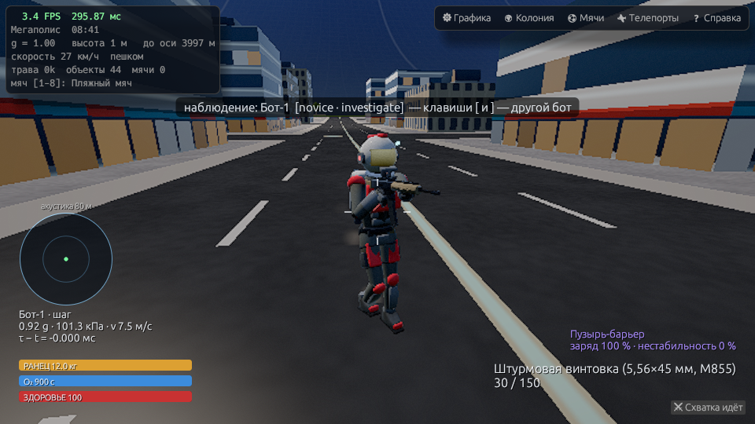
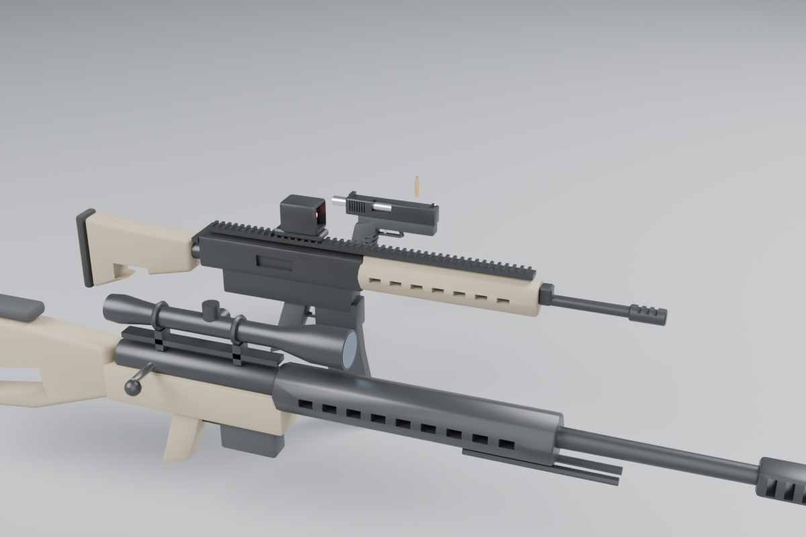
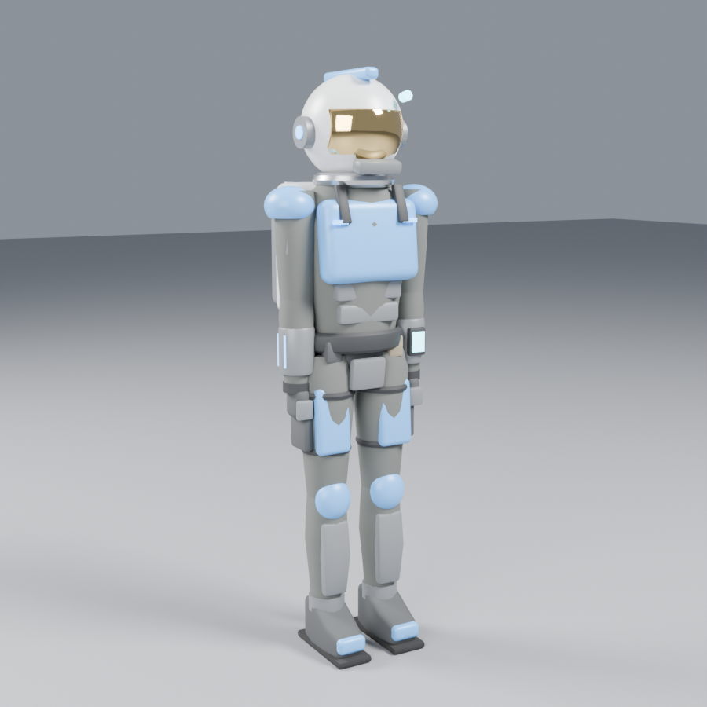
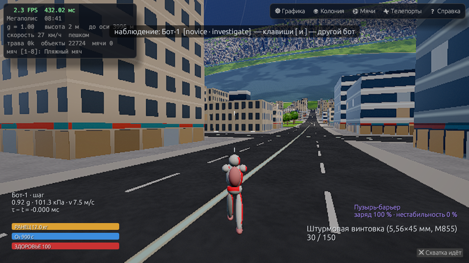
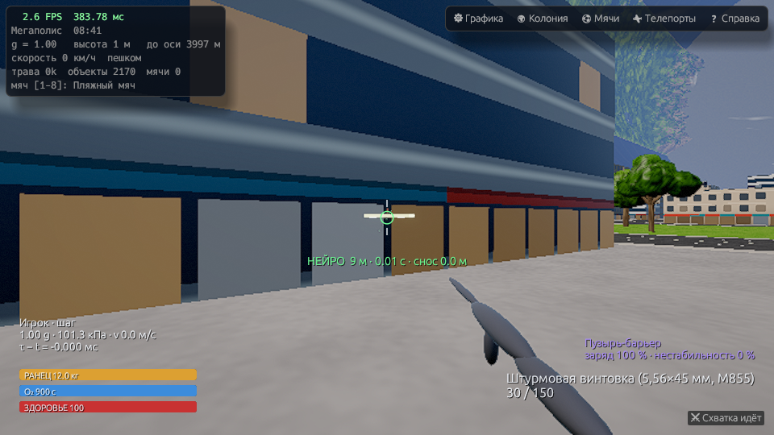

# История разработки

Исторические заметки: описания и ограничения относятся к указанной версии.
Актуальный запуск описан в [README](../README.md).

# v1.0 — модели оружия и оперативников (Blender), эффекты, ощущение боя

Модели сделаны в **Blender 4.2 LTS, headless** — скриптами `tools/blender/*.py` (MCP не нужен: Blender
полностью управляется через свой Python API из командной строки, это воспроизводимо и версионируется в git).

```
blender -b -noaudio -P tools/blender/weapons.py   -- assets/models/weapons.omdl   out/wp_preview.png
blender -b -noaudio -P tools/blender/operative.py -- assets/models/operative.omdl out/op_preview.png
```
Скрипты строят геометрию (лофты, токарные тела, фаски, subdivision, булевы вырезы), запекают AO в Cycles
в атрибут цвета и экспортируют в компактный бинарный формат `.omdl` (`tools/blender/common.py::export_omdl`),
который вшивается в бинарник (`src/models.rs`, `include_bytes!`). Последний аргумент — превью-рендер (необязателен).

* **Оружие** (7.9k треугольников): пистолет, штурмовая винтовка (коллиматор с красной маркой, M-LOK цевьё,
  планка, дульный тормоз), снайперская .338 (оптика с линзами, затвор, сошки, ложа с вырезом); отдельные магазины
  и гильза; сокеты `grip_l`, `muzzle`, `sight`, `eject`.
* **Оперативник** (18k треугольников, 15 жёстких частей): шлем с золотым визором (френель), ранец жизнеобеспечения
  с баллонами и соплами, броне-пластины в цвете команды.
* **Анимация** (`src/avatar.rs`): процедурная — походка с IK стоп, приседание, полёт на ранце, поворот корпуса
  и головы за прицелом, хват оружия двумя руками (IK), отдача, перезарядка со сбросом магазина, падение при смерти.
* **Вид от первого лица**: руки + оружие, прицеливание через настоящий прицел модели (ПКМ), покачивание при ходьбе,
  инерция при поворотах, отдача, бег, смена оружия; у снайперки — оптика с маской и mil-dots (×4).
* **Эффекты** (`src/fx.rs`, `shaders/particles.wgsl`): дульные вспышки + дым + вспышка света, гильзы с отскоком,
  искры/пыль/осколки при попадании, брызги стекла, пыль шагов, факел ранца, ударная волна, смерть.
* **HUD**: красная виньетка урона / низкого HP, синяя — мало O₂, подтверждение убийства, тряска камеры,
  «акустический радар» (слышимые выстрелы/шаги в радиусе 80 м).

Отладка без мыши: `ONEILL_CHASE="az,dist,height"` — камера сзади (видно своё тело), `ONEILL_INPUT="fire,ads,fwd,run"` —
зажатые кнопки. Пример: `ONEILL_INPUT=ads cargo run --release -- --skirmish 8 --skirmish-skip 20 --frames 22 --screenshot out/ads.png`.

Игровая логика не менялась: botmatch `--minutes 10 --bots 8 --seed 1` → хэш `bb475235c7f6bca2` (как в v0.9).







# v0.9 — бой в колонии: рендер + HUD (`src/combat.rs`)

Ядро `gameplay` и боты `ai` теперь подключены к рендеру колонии. Арена 2×2 км вырезается из
настоящего мира (здания → укрытия, озёра → вода, где можно идти вброд), бойцы рисуются в 3D.

```
cargo run --release -- --skirmish 8                 # вы + 8 ботов (уровни вперемешку)
cargo run --release -- --skirmish 8 --spectate      # только наблюдать за ботами
cargo run --release -- --skirmish 6 --bots-level veteran --seed 7 --neuro
cargo run --release -- --skirmish 8 --spectate --skirmish-skip 120 --frames 30 --screenshot out/s.png
```
В игре: кнопка «⚔ Схватка» (справа внизу) — число ботов, уровень, наблюдение, seed; **K** — начать/выйти из боя вокруг себя.

| Клавиша | Действие |
|---|---|
| ЛКМ / ПКМ | огонь / прицел (чувствительность ×0.5) |
| 1–3, R | оружие, перезарядка |
| Q / E | устройство (пузырь-барьер, микро-ЧД, складка) / сменить режим |
| N | нейро-проекция: зелёная — реальная траектория (Кориолис, гравитация, ЧД), красная — «наивная» прямая |
| J или F, Z/X, M (держать) | ранец, крен, магнитные ботинки |
| Tab (держать) | таблица счёта |
| [ / ] | наблюдение: предыдущий/следующий бот |
| F12 | скриншот `screenshot_NNN.png` |

Что видно на экране: фигуры в скафандрах (эллипсоиды: ноги с шагом, торс, ранец, шлем с золотым визором,
оружие; цвет команды на панелях; погибшие лежат, неуязвимость после возрождения светится), оружие от
первого лица, трассеры каждого выстрела, вспышки, осколки стекла и обломки, кольца пузыря/микро-ЧД/складки,
контуры разбитых стёкол. HUD: прицел по разбросу, хит-маркер, стрелки урона, здоровье/O₂/топливо, g, кПа,
скорость, τ−t, патроны, заряд и нестабильность устройства, лента убийств, баннеры смерти и наблюдения.




Также в v0.9: перелезание через препятствия до 1.15 м (`mantle_height`), вода на арене (замедление вброд,
боты не лезут глубже 0.6 м), спавны не в озёрах, исправлена «обшивка» под впадинами рельефа.
Хеш `botmatch` (10 мин, seed 1) изменился с `ada97c57976d1ef0` на `bb475235c7f6bca2` — из-за новых правил
движения, это ожидаемо; детерминизм по-прежнему проверяется `--verify 3600`.

# v0.8 — задел под шутер (`crates/gameplay`, `crates/ai`)

Проект стал workspace'ом. Рендер (wgpu/winit/egui) не тронут; физика вынесена в библиотеки,
поверх них — безголовое игровое ядро и боты. Ничего из нового не зависит от wgpu/winit.

| crate | что внутри |
|---|---|
| `relativity` | бывший `bh/physics.rs` — метрика, геодезические, PW-потенциал |
| `structure` | граф прочности станции, разрушение Вороного; новое: `Station::puncture` (пробой окна → утечка) |
| `oneill_world` | колония, мир, физика ходьбы v0.7 |
| `gameplay` | детерминированный тик 60 Гц, свой ECS, контроллер, баллистика, устройства, правила, хеш |
| `ai` | навигация, восприятие, прицеливание, utility-AI, `botmatch` |

## Запуск
```bash
cargo test --release --workspace                      # все тесты (~85)
cargo run --release -p ai --bin botmatch -- --minutes 10 --verify 3600
cargo run --release -p ai --bin botmatch -- --minutes 5 --bh        # бой на станции, падающей в ЧД
cargo run --release -p ai --bin botmatch -- --levels veteran,novice  # выбор уровней ботов
```
Лог — `out/botmatch.log` (каждое убийство, отказы устройств, поминутная статистика, итоговая таблица, хеш).

## Ядро (`gameplay`)
* **Тик и сеть.** `Sim::step(&[Command])`, `DT = 1/60`. `Command` квантован (движение i8, взгляд — дельта
  в 0.1 мрад), помечен тиком; `CommandLog` — буфер для отката. Состояние `Clone` → rollback; `state_hash()`
  (FNV по всем компонентам). Тригонометрия/exp — через `libm` (`det.rs`), случайность — `Rng::keyed(seed, tick, entity, …)`,
  без глобального состояния. Тесты: одинаковые команды → одинаковый хеш, откат+пересчёт → тот же хеш, режим ЧД тоже.
* **Собственное время.** У каждой сущности `ProperTime { tau, rate }`: dτ/dt по гравпотенциалу ЧД (PW), скорости
  и пузырю-барьеру (внутри время идёт ×2).
* **Контроллер во вращающейся СО.** «Вверх» — к оси, вес = ω²r, Кориолис и приливы ЧД — в `StationFrame::accel`.
  Ходьба/бег/присед/прыжок; сцепление ограничено трением μN (при малом весе не разгонишься); перелезание
  через препятствия до 1.15 м (`mantle_height`); у оси и снаружи — невесомость и 6DOF-ранец
  (уравнение Циолковского, расход топлива). Магнитные ботинки на обшивке.
* **Здоровье.** Удар о землю/стену по скорости, гипоксия, эбуллизм (предел Армстронга), баротравма от
  скорости падения давления, приливное растяжение, радиация (доза в Гр). Атмосфера — гидростатический
  профиль во вращении; разбитые окна стравливают её (истечение со скоростью звука), есть ветер к пробоине.
* **Баллистика.** Пуля — снаряд, RK4 с подшагами ≤ 4 м: центробежная, Кориолис, приливы ЧД (дифференциальный PW),
  гравитация микро-ЧД, сопротивление по полной таблице G7 с BC и плотностью воздуха на высоте. Пробитие/рикошет
  по материалам, стекло и лёгкие конструкции разрушаются в осколки Вороного, окна пробиваются в `structure`.
  Тест: восток/запад на 500 м совпадает с 2ωd²/v в пределах ±5 % (360/820/940 м/с).
* **Оружие** — `assets/weapons.ron` (пистолет 9 мм, автомат 5.56, снайперская .308): масса пули, BC G7, V₀,
  темп, разброс, отдача, громкость.
* **Нейроинтерфейс.** Кнопка `NEURO` переключает `Pilot::neuro`; `hud::neuro_projection` даёт траекторию с учётом
  всей физики и отклонение от «наивной» прямой — для отрисовки в HUD.
* **Устройство кривизны** (`assets/devices.ron`): пузырь-барьер (отражает медленные снаряды, внутри время ×2),
  микро-ЧД (испаряется по Хокингу; если отказывает удержание — разогрев и потеря), складка-кротовина
  (может открыться не туда, в т.ч. сквозь пол). Каждое включение копит нестабильность; вероятность отказа
  1 − exp(−I/I₀); отказы — сдвиговые волны, схлопывание пузыря, срыв удержания.
* **Карта.** `Arena::prototype` — квартал 2×2 км в долине «Мегаполис» у оконной полосы: кварталы 90 м с улицами,
  поле с рельефом, тюками и сараями, ~200 м оконного стекла из панелей 5 м со стальными переплётами.
  `Arena::from_world` вырезает тот же район из процедурного мира. Режим «Схватка»: `Sim::skirmish(.., human, 8)`.

## Боты (`ai`)
* **Навигация** — A* (октиль, целочисленные стоимости, лимит раскрытий) по сетке 4 м в развёртке цилиндра
  (u = длина дуги, v = ось; при полном обхвате u замыкается). Стекло ×3 (одно попадание — и под ногами вакуум),
  препятствия по пояс — «перелезть», разбитое окно/разрушенный объект перестраивают клетки на лету.
  Сглаживание string-pulling, флаги укрытий. Невесомость — `nav3d`: компенсация фиктивных сил + профиль торможения,
  обход шпинделя.
* **Восприятие** — конус зрения + линия видимости, дальность зависит от позы и движения; слух: звук идёт
  со скоростью звука (выстрел за 1 км слышно через ~3 с), затухание 1/r² и поглощение, −20 дБ при 0.1 атм,
  в вакууме тишина; попадание в бота выдаёт направление на стрелка.
* **Мозг** — utility AI: патруль, проверить шум, атака, укрытие, отступление, обход с фланга; гистерезис.
* **Прицеливание** — итеративный решатель по `closest_approach` с моделью мира бота: новичок не знает про
  Кориолис (на 500 м из снайперки мимо на ~15 м), ветеран учитывает всё и попадает (< 0.3 м, тест).
  Все боты смотрят на свои трассеры и смещают точку прицеливания — новичок «пристреливается» за несколько выстрелов.
  Огонь только в пределах эффективной дальности (своя ошибка + разброс оружия), очереди, перезарядка, выбор оружия.

## Итог `botmatch` (9 ботов, 10 мин, seed 1)
54× быстрее реального времени на одном ядре: sim ≈ 0.01 мс/тик, AI ≈ 0.3 мс/тик (все 9 ботов), худший тик ≈ 12 мс
(длинный A*). Повтор первых 3600 тиков с нуля дал тот же хеш.

## Честно о границах
* Ядро не подключено к рендеру: в окне пока прежняя ходьба v0.7. Следующий шаг — `main.rs` гоняет `Sim`
  и рисует тела/пули/HUD.
* Детерминизм гарантирован в пределах одной сборки/платформы; `structure` (режим ЧД) ещё на `std`-математике —
  для кросс-платформенного lockstep её тоже нужно перевести на `libm`.
* Здания — сплошные коробки (внутрь не войти), лестниц нет; карта большая для 9 ботов, поэтому темп боя невысокий.
* Боты считают по полной физике мира, но «знают» только то, что увидели/услышали.

# v0.7 — колония внутри настоящей чёрной дыры

Два проекта объединены: колония (`oneill_colony`) и физика/трассировщик чёрной дыры теперь
одна библиотека `oneill_colony::bh` (`src/bh/`), которую используют оба бинарника.

**Режим «Чёрная дыра» в колонии** — `oneill_colony --blackhole [сценарий]` или клавиша **B** в игре
(по умолчанию `scenarios/colony_sgr.toml`: Остров III падает в Sgr A* со скоростью «дождя» с r = 7 M, 20° над диском).

* Вы ходите по колонии, а снаружи идёт точная симуляция: станция = структурный граф 396 панелей
  (24 сектора × 16 колец + 2×6 секторов торцов), каждая со своими часами; фрагменты летят по своим PG-геодезикам.
* Небо за окнами — env-кубкарта (Rgba16Float, 192², `ONEILL_ENV=256` для 256²), которую трассирует
  тот же GPU-трассировщик из точки и с 4-скоростью *вашего фрагмента* (аберрация, g⁴, линзирование).
  Первый кадр — все 6 граней, дальше 1 грань/кадр (настраивается в панели).
* Свет: грань кубкарты читается обратно асинхронно, интегрируется Σ L·dΩ и Σ L·n̂·dΩ →
  направление, цвет и сила направленного света + диффузная часть. Свет попадает в долину только когда
  источник виден в противоположном окне (±15° по азимуту) — вращение 127 с даёт «день» в несколько секунд
  и полосы света, бегущие по долинам. Глаз адаптируется (~2 с).
* Приливы: игрок и мячи чувствуют точный тензор Марка `K·(p − COM)` плюс центробежную/кориолисову силу
  вращающейся системы *своего* фрагмента (после разлома ось и центр вращения меняются).
* Разрушение: каждая панель получает жёсткое преобразование (storage-буфер, 396 матриц) во всех вершинных
  шейдерах (рельеф, корпус, окна, здания/деревья по точке установки, трава по корню, аэрокары);
  треугольники на шве между разными фрагментами отбрасываются (varying fid vs flat fid). Небо в режиме ЧД
  рисуется «за бесконечностью», поэтому обломки дальше 100 км не пропадают.
* Давление падает при разгерметизации → дымка и рассеяние исчезают; обломки/стекло/воздух — частицы.
* Панель «Чёрная дыра»: r, t удалённый (от старта), τ станции, τ камеры (часы панели под вами),
  dτ/dt обоих, «снаружи прошло», разница часов ближнего/дальнего концов и разброс, прилив, состояние корпуса,
  давление; режимы времени τ станции / τ камеры / t удалённый, множитель ×0.01…×1000, пауза, сброс, яркость неба.
* Ключи: `--blackhole <имя|путь>`, `--bh-skip <с>` (перемотать часы станции), `ONEILL_BH_LIT=k`
  (ждать, пока дыра не засветит долину k), `ONEILL_ENV_DUMP=1` (грани кубкарты в /data/env_face*.png).

**Масштаб «как в жизни», а не макет** (работает и в обычном режиме):
* хроматическая воздушная перспектива: Рэлей (β ∝ λ⁻⁴, 5.8/13.5/33.1·10⁻⁶ м⁻¹) + Ми-дымка с фазой
  Хеньи–Гринстейна g = 0.76, интеграл плотности по лучу (4 точки Гаусса);
* плотность воздуха падает к оси по гидростатике во вращении: ρ ∝ exp(−0.237 (1 − r²/R²));
* облачный слой на 1.5 км: луч вверх пересекает его дважды — основания облаков над вами и освещённые
  верхушки над противоположной сушей, с параллаксом и дрейфом по ветру (ползунок «Облака»);
* удалённые объекты теряют контраст и синеют, дальний торец (32 км) растворяется в светящейся дымке.

**Керр** — `[disk] spin = a` в сценарии: отдельный путь трассировщика в декартовых координатах Керра–Шильда
(регулярны на горизонте), гамильтоновы уравнения с аналитическим градиентом, RK4; диск Кеплера от ISCO.
Сценарии `kerr_a09` (a = 0.9) и `kerr_a0001` (кросс-проверка с Шварцшильдом: картинки совпадают).
Камера в Керр-режиме — статическая (без полной PG-модели времени, она пока только у Шварцшильда).

**Новые сценарии:** `colony_sgr`, `sgr_breakup` (разлом на r ≈ 5.1 M, 7 фрагментов к 1.4 M),
`sgr_delay_on/off` (запаздывание света: вторичное изображение показывает станцию в другой момент),
`hover_2_05M` / `fall_2_05M` (контрольные кадры: висящий видит небо, сжатое в яркий диск; падающий — почти обычное
слегка покрасневшее небо — миф про «бесконечно синее небо» не подтверждается), `kerr_a0`, `kerr_a09`, `kerr_a0001`.

**Тесты** (`cargo test --release`): статический √(1−2M/r), круговая √(1−3M/r), «дождь» 1−2M/r, конечное время
падения против аналитики, регулярность на горизонте, тензор приливов, граф и разлом станции, сохранение
импульса при разломе, детерминизм, кольцевой буфер снимков, удалённый наблюдатель не видит пересечения горизонта,
энергия радиального фотона, Керр (ISCO a = 0/0.9/1, фотонные орбиты, сохранение H и L_z, край тени
против аналитики 3√r_ph ∓ a, аналитический градиент против численного), валидация всех WGSL-шейдеров naga.

# v0.4 — канонический масштаб и фотореализм

* Цилиндр O'Neill Island Three: R = 4 км (Ø 8 км), L = 32 км, период вращения ~127 с (1 g).
* Мегаполис с ар-деко башнями (ступенчатые уступы, песчаник), 12 деревень, 5 станций, горы до ~1 км, ~1.4 млн деревьев.
* Приглушённая «спутниковая» палитра полей, окна с несущей решёткой, осевой спиндель с модулями станций.
* Вид снаружи: поворотные зеркала (угол зависит от времени суток), корпус с панелями и огнями,
  агро-кольцо на солнечном торце, Млечный Путь с пылевыми полосами и туманностями, атмосфера внутри цилиндра считается по длине луча в воздухе.
* Оптимизация: тайловое отсечение объектов (CPU отбрасывает ~5.8 тыс. тайлов, GPU отсекает только их содержимое),
  лимит буферов деревьев, высоты и зоны за один проход, префильтрация мелких узоров (торцы, окна, огни) против алиасинга.
* v0.4.1: составные небоскрёбы (стилобат, ствол, уступ, корона, техэтажи, мачты, башни-близнецы со скайбриджем), спандрелы и техэтажи на фасадах, деревья не растут на дорогах и улицах деревень, подсвеченный корпус и экспозиция «в космосе».
* Телепорт 10 — «Снаружи», свободный полёт в вакууме. Кино-камера: `ONEILL_CAM=x,y,z,tx,ty,tz`.

# Колония О'Нила — «Остров Три»

Симулятор вращающейся космической колонии на **Rust + wgpu + WGSL** (Vulkan). Всё процедурное: ни одного файла-ассета, мир генерируется при запуске.

* Цилиндр R = 800 м, длина 6,4 км, вращение даёт 1 g на «земле».
* Три полосы суши, между ними три окна, через которые видно солнце:
  **Пастораль** (поля пшеницы/лаванды/рапса, деревни, фермы, теплицы, река),
  **Мегаполис** (даунтаун из небоскрёбов, проспекты, набережная, парки, озеро, канал),
  **Дикие земли** (около 65 тыс. деревьев, озёра, горы у торцов).
* Транспорт: 6 маглев-поездов по 6 вагонов (разгоняются, тормозят на станциях, разворачиваются на концах; на них можно ехать) и до 1600 аэромобилей на нескольких эшелонах.
* Цикл дня и ночи (зеркала окон), облака с тенями, дождь из мячей, ночные огни города.
* Трава из прошлой версии: миллионы травинок, которые приминаются от мячей и шагов.

## Изюминка — честная физика вращения
Гравитации в колонии нет, есть только вращение. Мячи считаются во вращающейся системе отсчёта (центробежная сила, **Кориолис**, сопротивление и плавучесть воздуха и воды):
* брошенный мяч уходит вбок, а при прицеливании (ПКМ) рисуются **две траектории**: настоящая и «как на Земле»;
* **гелиевый шар** всплывает к оси вращения;
* у оси наступает **невесомость** (телепорт «Ось»);
* в окне «Колония О'Нила» Кориолис можно выключить для сравнения, а «Гравитация у пола» меняет скорость вращения.

Мячи: пляжный, футбольный, баскетбольный, боулинг, светящаяся сфера (это источник света), валун 7 т, хромированная сфера, гелиевый шар.

## Сборка на Ultramarine / Fedora
```bash
# драйвер NVIDIA из RPM Fusion (если ещё не стоит)
sudo dnf install akmod-nvidia xorg-x11-drv-nvidia-cuda
# компилятор и Vulkan
sudo dnf install gcc vulkan-loader vulkan-tools
curl --proto '=https' --tlsv1.2 -sSf https://sh.rustup.rs | sh

cd oneill
cargo run --release -- --preset teapot      # для слабой видеокарты
```
Проверить, что Vulkan видит NVIDIA: `vulkaninfo --summary`.

## Пресеты графики
| Пресет | Для чего |
|---|---|
| `teapot` | «чайник»: рендер 50 %, без теней и MSAA, короткая трава, мало деревьев и машин |
| `low` | слабые/старые GPU |
| `medium` | по умолчанию |
| `high` | MSAA 4×, тени 2048, густая трава |
| `ultra` | тени 4096, трава до 95 м, дальние деревья |

Любой параметр меняется на лету в окне **«Настройки графики»** (Tab → меню): масштаб рендера, сглаживание (FXAA, MSAA 2×/4×, резкость CAS), разрешение и дальность теней, плотность/радиус/LOD травы, дальность деревьев, детализация рельефа, число аэромобилей, bloom, тонмаппинг AgX/ACES, экспозиция, насыщенность, дымка, виньетка, V-Sync, лимит FPS. В HUD показываются FPS, время кадра и число травинок и объектов.

## Управление
| Клавиша | Действие |
|---|---|
| Tab / клик | захват мыши ↔ курсор для меню |
| WASD, мышь | ходьба и взгляд, Shift — бег |
| Space | прыжок (в полёте — вверх), C/Ctrl — вниз |
| F | полёт вкл/выкл, колесо — скорость полёта |
| ЛКМ | бросить мяч; **ПКМ (держать)** — прицел с траекторией |
| 1–8 | тип мяча |
| G | пнуть ближайший мяч |
| R | дождь мячей с оси |
| T | сесть на маглев / сойти |
| P | пауза времени суток |
| V | показать поле динамики травы |
| F1 | скрыть интерфейс |

Окна: «Колония О'Нила» (время суток, длина суток, гравитация и ω, сила Кориолиса, ветер), «Мячи», «Телепорты» (11 точек: луг, поля, проспект, набережная, над крышами, лес, эко-деревня, горы, променад у окна, ось, торец).

## Ключи командной строки
```
--preset teapot|low|medium|high|ultra   --no-vsync   --size 1280x720
--teleport N   --time 0..1   --look yaw,pitch   --hide-ui   --rain   --aim   --frames N
```
Пример: `cargo run --release -- --preset high --teleport 4 --time 0.7`.

## Как устроена оптимизация
* **GPU-отбор травы** (compute): травинки генерируются из хеша прямо на GPU, отсекаются по пирамиде видимости и дистанции, разделяются на ближний (13 вершин) и дальний (5 вершин) LOD и прореживаются с расстоянием. Рисование через `draw_indirect`, без вершинных буферов и без участия CPU.
* **GPU-отбор объектов**: деревья, дома и прочее (сотни тысяч инстансов) отбираются compute-шейдером по пирамиде и дистанции и раскладываются по корзинам LOD с indirect-рисованием.
* **Поле динамики травы** (ping-pong текстура): примятость и изгиб от мячей и шагов, разрешение подбирается под радиус травы.
* Рельеф разбит на чанки с 4 LOD; тени — одна карта теней вокруг игрока (её можно отключить).
* Пост-обработка: HDR → bloom (6 мипов) → AgX/ACES → FXAA + CAS. Рендер в пониженном разрешении с апскейлом.
* CPU: сетка коллайдеров с ячейкой 32 м, статистика читается с GPU асинхронно, без остановки кадра.

Отладка: переменная `ONEILL_SKIP` с буквами `g c f o t s a` отключает проходы (трава, отбор травы, поле, объекты, рельеф, оболочка, аэромобили). `cargo test --test shaders` проверяет все WGSL через naga.

## Почему не Bevy
У Bevy нет готовых наборов «AAA-ассетов» для такой сцены: модели и текстуры всё равно пришлось бы искать отдельно. Кроме того, его стандартный PBR-конвейер тяжелее, чем нужно для слабой видеокарты. Свой рендер на wgpu (та же основа, что у Bevy) позволил сделать всю сцену процедурной: архив весит килобайты, а траву, объекты и LOD целиком обрабатывает GPU.

## Честная оговорка
Разработка и проверка шли без видеокарты, на программном Vulkan (lavapipe). Картинка и логика проверены, а FPS на реальной NVIDIA не замерялся. Если будет тормозить, начните с `--preset teapot` и поднимайте «Масштаб рендера» и дальность травы в настройках.

## Обновление графики (v0.3)
* Новые деревья: лиственные с ветвями и кроной из 9 кластеров, ели из 7 ярусов с рваным краем; «нормали кроны» для мягкого объёма, AO внутри кроны, шум листвы и просветы, просвечивание на солнце, глянец.
* Разнообразие: голубые ели, берёзы с белой корой, ~7 % осенних деревьев, вариации оттенка.
* Вода: волны крупнее и гаснут с расстоянием (без муара), отражение берега и «неба» колонии, блики солнца.
* Город: витрины с маркизами на первых этажах, затемнение у основания зданий; теплицы — стекло с грядками и геодезический каркас, ночью фитолампы.
* Детальные деревья рисуются ближе (18 % дальности), дальше — упрощённый LOD: на слабой видеокарте это компенсирует более сложную геометрию.
* Точки телепортов очищены от деревьев.

---

# v0.6 — режим «Чёрная дыра» (`blackhole`)

Отдельный бинарник, основное приложение колонии (`oneill_colony`) не менялось
(только правки под clippy). Подробности решений и ограничений — в `DECISIONS.md`.

## Сборка и запуск

```bash
cargo build --release --bin blackhole
cargo run --release --bin gen_sky -- 1024     # необязательно: заранее запечь HDR-небо
./target/release/blackhole                     # окно
./target/release/blackhole --info              # адаптер, пресеты
./target/release/blackhole --headless --scenario edge_on --out out
./target/release/blackhole --headless --scenario demo --frames 600 --size 320x180 --quality low --out out
```

Ключи: `--headless`, `--scenario <имя|путь.toml>`, `--frames N`, `--out DIR`,
`--size WxH`, `--quality low|medium|high|ultra`, `--hide-ui`, `--no-vsync`.
Headless пишет PNG-кадры и `<сценарий>_stats.csv` (время GPU по проходам, t, τ, dτ/dt, хэш состояния).

Небо (`assets/sky_<N>.bin`, ~67 МБ для 1024²×6, f16) генерируется при первом запуске (~7 с) и кешируется;
в архив не входит.

## Управление

| Клавиша | Действие |
|---|---|
| 1 / 2 / 3 / 4 | камера: орбита / свободная / со станции / кинематографическая |
| ЛКМ + мышь, колесо | вращение и дистанция (орбита) |
| WASD, Q/E, Shift | полёт (свободная), ×10 |
| ПКМ + мышь | обзор |
| Space | пауза |
| Tab | панели настроек (качество, экспозиция, режим времени t/τ, отладка зон/шагов/g) |
| F1 | скрыть HUD |
| R | перезапуск сценария |
| Esc | выход |

## Сценарии (`scenarios/`)

`edge_on`, `top_down`, `view_15deg`, `from_10m`, `from_3_5m` — контрольные кадры;
`fall_remote` / `fall_proper` — падение станции в времени удалённого наблюдателя (застывает и краснеет у горизонта)
и в собственном времени (пересекает горизонт за конечное τ); `demo` — 150-секундный кинематографический пролёт.

## Архитектура

`physics.rs` (геодезические Шварцшильда, ISCO, приливы) → `sim.rs` (режимы времени, кинематика камеры, станция) →
`render.rs` (wgpu: trace → resolve → bilateral upscale → экспонометр → bloom → tonemap AgX/ACES → egui) .
Шейдеры — `shaders/blackhole/*.wgsl`: точное уравнение u''+u=3u² (RK4 с адаптивным шагом), аналитические пересечения
с плоскостью диска (первичное и вторичные изображения), диск Новикова–Торна с цветом чёрного тела и g⁴ (Доплер + гравитационное
смещение), фотонное кольцо, линзированное HDR-небо с mip-LOD по расхождению лучей.
CPU-трассировщик `null_geo.rs` — эталон для тестов.

## Физические допущения

- Шварцшильд (a = 0), без Керра; диск тонкий, оптически толстый, излучение — локальное чёрное тело NT-профиля.
- Станция — точечный маркер с точным красным смещением; структурное разрушение пока не реализовано.
- Камера статическая / «дождевая» / на орбите; аберрация учитывается по 4-скорости наблюдателя.

FPS на lavapipe (CPU-Vulkan в VM) не показателен — замеры бюджета кадра нужно делать на реальном GPU.
